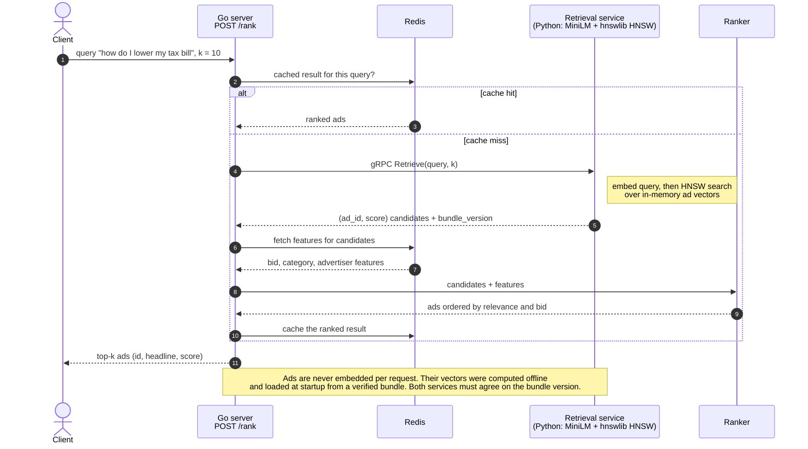

# Ad Retrieval & Ranking

A small but realistic ad-serving system. Given a free-text query such as *"how do I lower my
tax bill"*, it returns the most relevant ads ranked by relevance and bid, within a real-time
latency budget.

It's built the way production ad stacks are split:

- **An offline ingestion pipeline (Python)** validates and cleans raw ad data, turns every ad
  into a semantic embedding, and publishes a versioned, checksummed bundle.
- **A retrieval service (Python)** owns everything that touches vectors: it loads the bundle,
  embeds each query with the same pinned model, and searches an approximate nearest-neighbour
  index (hnswlib HNSW).
- **An online serving layer (Go)** handles the request path: concurrency, deadlines and
  backpressure, Redis as both the feature store and the cache, and ranking. It calls the
  retrieval service over **gRPC** and never handles a vector itself.

The goal isn't scale for its own sake. It's to make the decisions a real ad system depends on
explicit, tested and measured: what counts as bad data, how vectors are produced and shipped,
how the serving process knows its data is intact, and what accuracy is lost when exact search
becomes approximate.

## How an ad request is served



1. **One gRPC call does all the vector work.** The retrieval service embeds the query with the
   same pinned model that embedded the ads offline, then searches all 44,200 ad vectors with an
   HNSW index and returns `(ad_id, score)` pairs. Go sends text and gets back IDs, so no vectors
   cross the wire.
2. **The two services must agree on the data.** Go checks at startup that the service's model
   and bundle version match its own manifest, and checks `bundle_version` on every response.
   Otherwise an `ad_id` could point at the wrong ad.
3. **Ranking answers "which relevant ad should win?"** Candidates are scored on relevance plus
   explicit signals such as bid and category from the feature store, which is why bid and
   category are kept out of the vectors.
4. **Redis sits on both sides of the work.** It caches the final result for repeated queries
   and stores the per-ad features the ranker needs.

Everything on the request path reads from memory or Redis, apart from embedding the one short
query. The expensive step, embedding the ad corpus, happens offline in the Python pipeline,
which publishes a versioned bundle that both services load at startup.

Go's concurrency lets the serving layer hold many requests in flight and fan out to Redis and
ranking in parallel. On a cache miss, though, throughput is capped by the retrieval service, so
that ceiling is measured with a load generator rather than assumed.

**Built:** data generation, validation + cleaning, embedding, atomic publishing, the Go loader
with exact top-k search, and the Python gRPC retrieval service (HNSW + exact search).
**In progress:** tuning HNSW against measured recall, the Go gRPC client, Redis, the ranking
model, the `/rank` HTTP API, and zero-downtime hot reload.

## Tech stack

| Layer | Technology | Why |
|---|---|---|
| Ingestion | **Python 3.11**, managed with **uv** | Pinned to 3.11 because the ML stack lags newer releases; `uv.lock` makes builds reproducible |
| Embeddings | **sentence-transformers** 6.0.1 (`all-MiniLM-L6-v2`), **PyTorch** 2.14, **NumPy** 2.4 | Small, fast 384-dim model; runs on Apple Silicon GPU (MPS) |
| Validation | Python standard library only | The rules stay visible instead of declared in a schema library |
| Retrieval | **hnswlib** (HNSW), served from Python over **gRPC** (`grpcio`) | C++ core that releases the GIL, and no OpenMP (see below); lives next to the model that embeds queries |
| Serving | **Go** | Cheap concurrency, deadlines and predictable latency on the request path; the bundle loader is standard library only |
| Service contract | **gRPC + protobuf** | One versioned `.proto` with generated code in both languages, plus per-call deadlines |
| Feature store / cache | **Redis** | Per-ad features and hot query results |
| Data format | JSONL + raw little-endian `float32` + a JSON manifest | Streamable, appendable, and loadable in one pass |
| Testing | **pytest** (189 fast + 8 model-loading), Go `testing` + benchmarks | Fast suite runs without downloading the model |
| Orchestration | **Make** | Every stage is a gate; a failure stops the pipeline |

## The data

### How the ads are produced

There's no public dataset of ad copy with a known amount of corruption, so the corpus is
synthetic. That's deliberate: `scripts/generate_raw_ads.py` creates it with a fixed seed, so
every run is reproducible.

- **50,000 raw ads** (`--count 50000 --seed 42`) across **12 categories**: apparel, footwear,
  electronics, home & kitchen, beauty, fitness, travel, finance, gaming, pet supplies, food
  delivery and education.
- Each category has its own catalogue of 8 brands, 10 products and 6 selling-point "hooks".
  Headlines come from 6 templates mixing those with adjectives and offers (e.g. *"Premium litter
  box enclosure from Mewtide — Save $25 on Your First Order"*), and are unique.
- **400 advertisers.** Bids are drawn from a log-normal distribution (median ≈ $2.46 CPM, capped
  at $45), which gives the low cluster and long right tail of real CPMs. `created_at` falls
  within the last 180 days, skewed towards recent.
- **Seeded defects:** about 11.6% of records get exactly **one** fatal defect each, at fixed rates.
  Examples include truncated JSON, missing fields, negative bids or cents sent as dollars,
  unknown categories, and duplicate IDs or content.
- **Fixable noise:** a further 15% get cosmetic damage the cleaner should repair: stray HTML,
  extra whitespace, zero-width spaces, `"$4.25"` as a string, or a missing description.

The generator also writes `expected_defects.json`, which records exactly what it injected. The
validator's report has to match it code for code, and `scripts/check_oracle.py` checks that.
**All 12 reject codes match exactly: 44,200 accepted (88.4%), 5,800 rejected.** You can't trust
a data-quality check you've never seen fire.

### How much we store

| Artifact | Size | Contents |
|---|---|---|
| `data/raw/ads_raw.jsonl` | 16.5 MB | 50,000 raw records, defects included |
| `data/clean/ads_clean.jsonl` | 14.4 MB | 44,200 accepted, cleaned records |
| `data/clean/ads_rejected.jsonl` | 2.7 MB | 5,800 rejects, each with a stable reason code |
| `data/embedded/embeddings.npy` | 67.9 MB | Intermediate 44,200 × 384 embedding matrix |
| **Published bundle** | **≈ 83 MB** | What the Go service loads (below) |

Each published bundle is a versioned directory:

```
data/published/
  LATEST                          -> text file naming the current version
  20260922T215211Z-4c4c2646/
    vectors.f32     67,891,200 bytes = 44,200 ads × 384 dims × 4 bytes, little-endian, row-major
    ads.jsonl       15.0 MB, one ad per line with an explicit `row`; line i ↔ vector row i
    manifest.json   counts, dims, SHA-256 checksums, model name + pinned revision, source provenance
```

The vectors are about 82% of the bundle. That scales linearly: **≈ 15 GB of raw float32 at 10M
ads**. At that size production systems quantize (int8 or product quantization) or move to
memory-mapped or sharded indexes.

### How it's loaded into memory

The Go loader treats the bundle as untrusted input and **fails closed**. The service refuses to
start rather than serve from data it can't verify.

1. **Resolve `LATEST`.** It's trimmed, and anything empty or containing `/` or `..` is rejected.
2. **Validate the manifest before reading any large file.** It checks the format version, that the
   vectors are `float32` / little-endian / row-major, that they're normalised for dot-product
   similarity, that the vector and ad counts agree, and that `bytes == count × dim × 4`. Cheap
   checks run first.
3. **Vectors.** `os.Stat` must match the expected size, which catches truncation without
   reading anything. The file is then read in a single pass, hashed with SHA-256 *while* reading,
   and decoded into **one flat `[]float32`** of 16,972,800 values (~68 MB). Row *i* is
   `v[i*384 : (i+1)*384]`.
   - Flat rather than `[][]float32`: one allocation, contiguous memory, and cache-friendly scans.
   - Decoded explicitly with `encoding/binary` rather than an `unsafe` cast, so it's correct on
     any CPU byte order. That costs milliseconds.
   - Every value must be finite and every row's length within `1e-3` of 1.0. Go re-checks this
     rather than trusting that the Python writer did.
4. **Ads.** `ads.jsonl` is streamed with a 1 MB-buffered scanner (the default 64 KB line limit
   is a known trap) and hashed while reading. Each line's `row` must equal its line index, and
   `ad_id`s must be unique. An `ad_id → row` map is built for lookups.
5. **Immutable result.** `Load` returns a `*Bundle` that nothing mutates afterwards. Hot reload
   then becomes building a new bundle in the background and swapping an `atomic.Pointer`, with
   no locks on the request path.

Exact top-k search runs on the loaded bundle: a dot product against all 44,200 rows, keeping a
size-k min-heap, which is O(N log k). It's checked against the Python brute-force results, which
proves both languages read the bundle format identically. The same exact results are the ground
truth that HNSW's recall is measured against, which turns the accuracy-vs-speed trade-off into a
measurement rather than a claim.

## The retrieval service

`python -m retrieval` turns query text into the nearest ads, over gRPC. It owns everything that
touches a vector at request time, so the Go serving layer only ever sends text and receives
`(ad_id, score)` pairs.

**The contract** is one file, `proto/adretrieval/v1/retrieval.proto`, with two calls:

- `Retrieve(query, k, exact)` returns hits (best first), plus the `bundle_version` they came
  from and how long embedding and search took. `exact = true` runs brute-force search instead of
  HNSW. That's used for evaluation, and for spot-checking recall on live traffic.
- `GetInfo()` returns the bundle version, the model name, revision and dimension, and the HNSW
  settings. A client compares these with its own manifest and refuses to send traffic on any
  mismatch.

Bad requests come back as gRPC status codes, not error fields: `INVALID_ARGUMENT` for an empty
query, one over the model's token limit (rejected, never silently truncated), or `k` outside
1..1000. The standard `grpc.health.v1` service is served alongside.

**Startup is ordered so a client that can connect can be served:**

1. Verify the bundle. This is the same contract as the Go loader (manifest first, then sizes,
   SHA-256, finite unit vectors, row alignment, unique ids), checked again because this is the
   side that searches the vectors.
2. Load the model the manifest names, and refuse to start if its name, revision or dimension
   differ.
3. Build the indexes.
4. Run one warm-up query, so the first real query isn't the slow one.
5. Only then bind the port.

On SIGTERM, health flips to `NOT_SERVING` so load balancers stop routing to it, and in-flight
requests get 5 s to finish.

**The request path:**

1. Clean the query with the same helpers the ads went through.
2. Check the token limit.
3. Embed the query.
4. Search, and map rows to `ad_id`s.

Requests run on a thread pool (8 by default). That gives real parallelism because torch and
hnswlib both release the GIL. Each request uses one torch thread and one hnswlib thread, so 8
concurrent requests don't each try to use every core.

**Findings while building it:**

- **faiss and torch can't share a process here.** On macOS, both pip wheels bundle their own
  OpenMP runtime. With both loaded, the first parallel region crashed (`OMP: Error #179`, then a
  segfault), whichever was imported first. Pinning OpenMP to one thread stopped the crash, but
  two OpenMP runtimes in one process is unsupported. hnswlib uses plain threads instead.
- **The trade-off.** hnswlib's `ef` is a property of the index, not of a query, so it's fixed at
  startup (`--ef-search`) rather than settable per request. Building the 44,200-vector graph also
  takes ~35 s single-threaded. Single-threaded is deliberate: the same bundle and settings then
  always build the same graph, so recall numbers can be reproduced.
- **gRPC turns on `SO_REUSEPORT` by default.** That would let a second server, possibly one
  serving an older bundle, bind the same port and silently share its traffic. It's turned off,
  so a second bind fails loudly.

## Key design decisions

**Clean first, then validate.** A headline of `"   "` isn't empty until it's trimmed, and
`"<b>Sale!</b>"` isn't 12 characters of ad copy, it's 5. Length checks run on the cleaned text,
because cleaned text is what gets embedded. Every problem is either **fixable** (cleaned, kept,
warning logged) or **fatal** (rejected with a stable code like `E008_BID_OUT_OF_RANGE`).

**Stable reason codes, not free text.** They make the report countable and alertable: the
difference between *"some ads failed"* and *"4.1% failed on bid range, up from 0.2% yesterday."*

**What goes into the vector.** It's `"{headline}. {description}"`. Category and bid are
deliberately left out: ranking scores them as separate, explicit signals. Folding category into
the vector would count it twice, and a bid isn't meaning at all.

**Unit vectors, so similarity is a dot product.** Every vector is L2-normalised, so cosine
similarity equals the dot product and the hot path needs no square roots.

**Ads are embedded offline, queries at request time.** Embedding all 44,200 ads takes ~25 s and
nobody is waiting on it. The serving path embeds only the single short query.

**Guards against silent failure:**

| Guard | The quiet disaster it prevents |
|---|---|
| Token gate | The model truncates at 256 tokens without saying so. Token counts are checked with the model's own tokenizer before embedding. |
| Staleness guard | Publishing stale vectors after re-validating would pair every vector with the *wrong* ad. Publish re-hashes the clean data and refuses if it changed. |
| Integrity checks | A NaN row is invisible to search, and an all-zero row can never be retrieved. Both are rejected. |
| Model identity in the manifest | Query and ad vectors from different models give plausible-looking scores that mean nothing. The retrieval service reads the model from the manifest instead of hard-coding it, and Go checks it at startup. |
| Atomic publishing | The bundle is written to a staging directory, `fsync`ed and renamed; `LATEST` is updated last. Readers see the old bundle or the new one, never a mixture. |

## Results so far (Apple M4)

```
validate   50,000 records in 0.82s   ≈ 61k records/sec, single-threaded; oracle matches exactly
embed      44,200 ads in 24.66s      1,792 ads/sec on the M4 GPU (mps), batch size 256
tokens     p50=37  p99=46  max=55    limit=256, truncated=0
publish    67,891,200 bytes          checksum verified
probe      category precision@5 = 40/40 = 100%
retrieval  startup: bundle verified 0.16s, model 2.2s, HNSW (M=16, efC=200) built ~35-39s
           per query: embed ~6-9ms, HNSW search ~0.5ms, exact search ~1.4ms (ef=64, CPU)
```

At this corpus size the query embedding, not the search, dominates request latency. Even exact
search is only ~3x slower than HNSW at 44,200 ads; the gap grows with the corpus. Recall at
different HNSW settings is being measured next.

**One honest finding.** For *"warm waterproof jacket for winter"*, the top hit is a denim jacket,
ahead of the rain shells and parkas. The model matched "jacket" and "winter" more strongly than
"waterproof". Category precision still scored 5/5 because denim is apparel, which shows the
limits of using category as a stand-in for a real relevance label.

## Running it

```bash
uv sync --extra dev --extra serve   # Python; Go 1.22+ is also needed for the serving side

make pipeline    # generate -> validate -> embed -> publish -> probe -> ground-truth -> loadcheck

# or one stage at a time
uv run python scripts/generate_raw_ads.py --count 50000 --seed 42
uv run python -m ingestion.validate --fail-under 0.85   # gate: non-zero exit stops the pipeline
uv run python scripts/check_oracle.py                   # report matches the seeded defects?
uv run python -m ingestion.embed                        # gate: fails on token-limit overflow
uv run python -m ingestion.publish                      # gate: fails on stale or broken vectors
uv run python scripts/probe_embeddings.py               # brute-force sanity search
make ground-truth   # exact top-10 + query vectors -> data/eval/ground_truth.json
make loadcheck      # Go loads + verifies the latest bundle; non-zero exit if it refuses
make retrieval      # gRPC retrieval service on :50051 (PORT=... to change)
make proto          # regenerate gRPC code after editing the .proto; make proto-check verifies it

make test        # Python fast suite, no model download
make test-slow   # the tests that load the real model
make go-test     # Go: corruption cases, self-match, parity with Python
make go-bench    # Go: load time and exact top-k latency
```

The Go tests that need real data (self-match, Python parity, benchmarks) skip on a fresh clone
because `data/` is gitignored. The parity test **fails** rather than skips if the ground truth
was taken from a different bundle than `LATEST` points to.

## Layout

```
ingestion/
  schema.py     AdRecord, the category taxonomy, every tunable limit
  clean.py      pure normalisation helpers (no I/O, no rejections)
  rules.py      one small function per rule -> None | Violation
  report.py     count aggregation, JSON artifact + terminal summary
  validate.py   CLI: streams raw -> clean/reject -> report
  fileutil.py   checksums + atomic JSON writes, shared by every stage
  embedder.py   Embedder protocol + the pinned MiniLM implementation
  embed.py      CLI: token gate -> batched embeddings.npy
  publish.py    CLI: verify -> versioned bundle -> atomic LATEST
scripts/
  generate_raw_ads.py   synthetic corpus with seeded defects + oracle
  check_oracle.py       diffs the report against the oracle
  probe_embeddings.py   exact brute-force search; also the retrieval ground truth
retrieval/
  bundle.py     load + verify the bundle: the Go loader's contract, in Python
  index.py      ExactIndex (numpy) and HNSWIndex (hnswlib), one search interface
  service.py    gRPC servicer: validate -> clean -> embed -> search -> ad_ids; server setup
  __main__.py   CLI: verify -> load model -> build -> warm up -> serve; graceful shutdown
proto/adretrieval/v1/retrieval.proto   the gRPC contract
adretrieval/v1/         generated Python code (committed; make proto-check keeps it current)
tests/                  pytest suite (fast + model-loading)
serving/                Go module, standard library only
  internal/bundle/
    manifest.go   manifest structs + contract checks, before any large file is read
    vectors.go    chunked read, SHA-256 while reading, flat []float32, finite + unit-norm checks
    ads.go        streams ads.jsonl, row i <-> line i, unique ad_ids, ad_id -> row index
    bundle.go     Load: LATEST -> verified, immutable *Bundle
    search.go     exact TopK with a size-k min-heap
  cmd/loadcheck/  CLI: load, verify, report load time + heap
```

Python and Go share one repository but no code. They have two interfaces. The first is the
bundle on disk, described by its manifest, so a format change lands in one commit with tests on
both sides. The second is the gRPC contract: one versioned `.proto` file, with code generated
for each language.

`embed.py` depends on a small `Embedder` protocol rather than on `sentence-transformers`
directly. The fast test suite plugs in a deterministic fake, so it never downloads 90 MB or
imports torch. Everything that can actually go wrong (the token gate, row alignment, checksums,
atomic publishing) is pipeline logic that doesn't need a real neural network to test.
